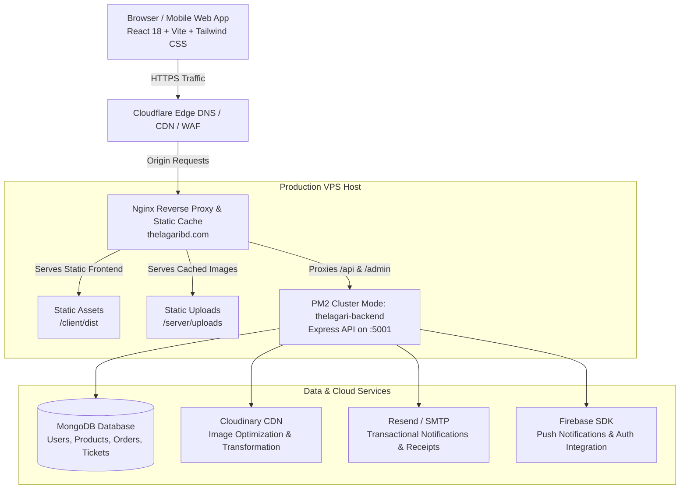

# Thelagari (Lumina Commerce) — Architecture & Tech Stack

This document details the architectural design, system boundaries, data flow, infrastructure, and component organization of Thelagari.

---

## 1. High-Level System Architecture

Thelagari is built as a decoupled, multi-tier modern e-commerce application designed for high performance, smooth micro-interactions, and robust security.



---

## 2. Technology Stack Breakdown

### Frontend Tier
- **Framework**: [React 18](https://react.dev/) with [Vite](https://vitejs.dev/) for high-speed builds and HMR.
- **Language**: TypeScript (`v5.8+`) ensuring strict typing across all components and data structures.
- **Styling & UI**: [Tailwind CSS](https://tailwindcss.com/), Radix UI primitives, Lucide Icons, and `@tanstack/react-query` for asynchronous server state management.
- **Animations & Micro-interactions**: Framer Motion and GSAP, coupled with Lenis smooth scrolling for luxury e-commerce aesthetics.
- **Form Validation**: `react-hook-form` with `zod` schema validation.

### Backend Tier
- **Runtime**: Node.js (`v20.x` LTS recommended).
- **Framework**: Express (`v4.21.x`) with ES Modules (`"type": "module"`).
- **Process Manager**: PM2 running in Cluster Mode with multi-core load balancing and auto-restart policies.
- **Security**: Helmet security headers, CORS origin whitelisting, Express Rate Limiter, and Cloudflare connecting IP restoration.
- **PDF Generation**: PDFKit for dynamically rendering branded customer invoices.

### Database & Persistence
- **Database**: MongoDB with Mongoose ODM (`v8.12+`).
- **Data Modeling**: Schema validation, indexes on high-traffic fields (`slug`, `category`, `status`, `createdAt`), and cascading hooks.

### Media & Third-Party Integrations
- **Media Delivery**: Cloudinary CDN + local disk fallback (`/uploads/`) with direct Nginx accelerated delivery.
- **Transactional Messaging**: Resend API / Nodemailer for order receipts, tracking notifications, and admin alerts.
- **Google Drive Backup**: `backup_to_gdrive.sh` automated backup script.

---

## 3. Directory Structure

```plaintext
thelagari/
├── client/                     # Vite + React Frontend
│   ├── public/                 # Static public assets
│   ├── src/
│   │   ├── components/         # Reusable UI & Admin components (AdminOrders, AdminProductList, etc.)
│   │   ├── hooks/              # Custom React hooks (useCart, useAuth, etc.)
│   │   ├── lib/                # API clients, axios configurations, helpers
│   │   ├── pages/              # Page routes (Products, Checkout, Admin, Account)
│   │   ├── types/              # TypeScript interface definitions
│   │   ├── App.tsx             # Main routing orchestrator
│   │   └── main.tsx            # React application entrypoint
│   └── vite.config.ts
├── server/                     # Express Backend API
│   ├── index.js                # App entrypoint, middleware, DB connection
│   ├── db.js                   # Mongoose connection logic
│   ├── middleware/             # Auth JWT, Admin gatekeeper, rate limiting
│   ├── models/                 # Mongoose schemas (15 models: Product, Order, User...)
│   ├── routes/                 # API routers (/api/products, /api/orders, /api/admin...)
│   ├── utils/                  # Invoices, mailers, image processors
│   ├── uploads/                # Local uploaded asset storage
│   └── backup_to_gdrive.sh     # Database backup automation script
├── docs/                       # Architecture, Setup, and Guides
├── deploy.sh                   # Zero-downtime production deployment script
├── nginx.conf                  # Nginx web server configuration with caching & security
└── package.json                # Project root workspace scripts
```

---

## 4. Key Data Models (Mongoose)

| Model | Purpose | Key Attributes |
| :--- | :--- | :--- |
| `User` | Customer & Admin Accounts | `name`, `email`, `password` (hashed), `role` (`customer`, `admin`, `manager`), `addresses` |
| `Product` | Catalog Items | `title`, `slug`, `price`, `discountPrice`, `stock`, `images`, `category`, `variants`, `isFeatured` |
| `Order` | Customer Transactions | `orderNumber`, `user`, `items`, `totalAmount`, `shippingAddress`, `status` (`pending`, `confirmed`, `shipped`, `delivered`, `cancelled`), `paymentMethod` |
| `Category` | Catalog Hierarchies | `name`, `slug`, `image`, `description`, `parentCategory` |
| `Cart` | Persistent Cart State | `userId`, `guestToken`, `items`, `updatedAt` |
| `Coupon` | Discounts & Campaigns | `code`, `discountType`, `discountValue`, `minimumOrderAmount`, `validUntil`, `usageLimit` |
| `SupportTicket` | Help Desk & Inquiries | `ticketNumber`, `user`, `subject`, `messages`, `status`, `priority` |
| `AuditLog` | Admin Action Tracking | `adminId`, `action`, `targetModel`, `targetId`, `timestamp`, `ipAddress` |
| `Settings` | Dynamic Site Config | Store policies, banner announcements, payment switchers, contact details |

---

## 5. Security & Authentication Model

1. **Authentication**:
   - JSON Web Tokens (JWT) signed with `JWT_SECRET`.
   - Admin routes guarded by `admin.js` middleware verifying valid JWT and `role === 'admin'`.
2. **Reverse Proxy Security (Nginx)**:
   - Protected Admin Paths: `/master`, `/admin`, `/api/admin`.
   - Security Headers: `HSTS` (63072000s), `X-Content-Type-Options: nosniff`, `X-Frame-Options: SAMEORIGIN`, and strict `CSP`.
   - IP Forwarding: Cloudflare proxy IPs mapped to `CF-Connecting-IP` to prevent IP spoofing and maintain accurate rate-limiting logs.
3. **Database Security**:
   - Passwords hashed using `bcryptjs` with salt rounds.
   - Strict sanitization of parameters to prevent NoSQL query injection.
